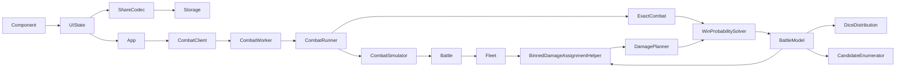

# Architecture

Luminary has a browser application layer and two battle execution paths that share ship and
damage-assignment rules:

- The application layer owns editable setup state, persistence, presentation, and interactive
  strategy selection.
- The simulation path samples dice and mutates live `Fleet` and `Ship` objects.
- The exact path enumerates dice outcomes and evaluates a graph of immutable HP states.

`Battle` is authoritative for user-visible combat semantics. When its schedule, terminal rules,
healing, or damage order changes, update the corresponding pure model behavior and contract
tests in the same change.



Dependencies point inward: browser components may use UI-domain rules and engine types, while
engine modules do not import UI state, DOM APIs, storage, or presentation code. `app.ts` is the
composition root between those layers.

## Engine Module Ownership

- `battle.ts`: authoritative mutable battle loop, phase order, healing boundaries, and terminal
  outcomes.
- `battle-rules.ts`: pure survival-to-terminal mapping shared by mutable and exact engines.
- `combat-result.ts`: the shared, engine-level outcome summary returned by exact and sampled
  execution. Interactive-only method and fallback metadata belongs to `combat-runner.ts`.
- `fleet.ts` and `ship.ts`: mutable combat entities, weapon rolls, planner lifetime, and battle
  reset behavior.
- `binned-damage-assignment-helper.ts`: routes NPC, DPS, initiative, and optimal assignments.
- `candidate-enumerator.ts`: legal distinct damage-assignment successors.
- `dice-distribution.ts`: exact probability distribution for a schedule slot.
- `battle-state.ts`: immutable exact-model schedule and one-slot state transitions. It does not
  solve graph values.
- `win-probability-solver.ts`: graph construction, minimax value iteration, and forward outcome
  propagation. It does not reproduce battle transitions.
- `optimal-damage-planner.ts`: adapts solved state values to the mutable planner interface and
  owns matchup-level solver caching.
- `exact-combat.ts`: converts one or more fleets into exact solves and maps their outcomes to the
  shared engine result shape. Multi-fleet combat composes adjacent two-fleet exact engagements in
  the same order as `MultiBattle`, carrying terminal HP into the next engagement. A request-local
  engagement cache excludes fleet names while retaining roles, policy, configuration, HP, and
  resolved phase order; the multi-fleet reporting layer applies fleet identity and attribution to
  cached terminal HP.
- `combat-runner.ts`: owns the interactive `exact-dps` → `exact-optimal` → `monte-carlo-dps`
  strategy ladder, its single request-wide deadline, the prediction that gates the optimal tier
  and the `SolverCalibration` it learns from each run, planner-safe fleet cloning, and serializable
  fallback diagnostics.

## Application and UI Ownership

- `app.ts`: application startup, routing, render scheduling, persistence wiring, and the boundary
  between editable UI state and engine fleets. It disposes prior bindings when reinitialized and
  maps engine identities/results to presentation. It also owns the latest-request-wins combat UI
  lifecycle, while combat policy belongs in the engine runner rather than being reproduced here.
- `ui/combat-client.ts` and `ui/combat-fleets.ts`: the asynchronous browser-worker boundary and its
  serializable fleet snapshot. The worker persists between requests; a new edit terminates a
  worker whose request is in flight, app-level request versions prevent a stale response from
  replacing newer odds, and the client carries the latest solver calibration into each request.
- `combat-worker.ts`: reconstructs engine fleets inside a dedicated worker and invokes the same
  `CombatRunner` used by tests and non-browser callers. It does not duplicate fallback policy.
- `main.ts`, `sw.js`, and `scripts/build-service-worker.ts`: register offline support immediately
  and generate a content-versioned first-install precache from the current build graph, including
  the combat worker and lazily displayed ship artwork.
- `ui/state.ts`: the only mutable browser setup store. Its atomic commands apply setup changes and
  notify subscribers; subscriptions return a disposer. Components should not reproduce
  fleet-validity rules before calling it.
- `ui/ship-config.ts`: pure normalization, deep cloning, and behavior-based equality for optional
  ship configurations.
- `ui/ship-parts.ts`: the official part catalog, slot geometry, faction/chassis bonuses, blueprint
  validation, and pure part-to-combat-stat derivation. Energy and drive validity are presentation
  warnings and do not enter the engine configuration.
- `ui/fleet-rules.ts`: pure defender/attacker legality, player/NPC compatibility, and first-valid
  composition sanitization. State commands, controls, and share-link decoding use the same rules.
- `ui/ship-presets.ts` and `ui/fleet-metadata.ts`: canonical preset, quantity, faction, label, color,
  and unique derived fleet-name data. They do not own browser state.
- `ui/share.ts`: the versioned query codec plus share/report formatting. Decoding is lenient about
  unknown input but delegates fleet legality and config comparison to the UI-domain helpers.
- `ui/storage.ts` and `ui/preferences.ts`: fail-soft browser persistence adapters. Stored battle
  setups use the share query as their single serialized format.
- `ui/components/*`: custom-element rendering and interaction. Each component keeps its template,
  styles, and focused tests together and delegates durable mutations to `ui/state.ts`.
- `ui/styles/tokens.css` and `ui/styles/primitives.css`: the production design-token and reusable
  control/layout contracts imported by `app.css`. Component styles own domain layout and artwork
  geometry, not alternate button/select/panel systems. See [ui-system.md](ui-system.md).

### Setup State Contract

Fleet position determines role: index 0 is the defender and later entries are attackers. Attackers
are assumed to be listed in order of entry into the sector, latest at the bottom; the engines do not
reorder them. Engagements resolve from the bottom of the list upward, and in each engagement the
upper fleet acts as the Defender: it fires first on initiative ties, holds the sector on a
stalemate, and is credited at the sampled round cap. NPCs, starbases, and orbitals are
defender-only; player hulls may mix, while an NPC fleet contains one NPC type. NPC fleets never hold
the Antimatter Splitter, a player technology: the fleet card hides it, the URL codec drops it, and
both engines ignore it. State keeps the player's choice, so it returns when the defender is swapped
from an NPC layout back to player ships. A fleet has at most one row and one configuration for each ship type. Input order matters
when sanitizing imported data: after role-invalid entries are removed, the first valid ship
determines player versus NPC composition, and the first row for each type is retained. State takes
ownership of imported and updated configurations and clamps quantities at this boundary.

When no faction is selected, a defender may choose either structure. A faction-selected Exiles
defender may field Orbitals but not Starbases; every other faction-selected defender may field
Starbases but not Orbitals. Rho Indi fleets may not field Dreadnoughts. Changing faction or importing
a faction-tagged setup removes a Rho Indi Dreadnought, and converts an invalid structure to its valid
counterpart, clamps its quantity to the new component limit, and applies the new structure's
faction-aware operating blueprint.

These rules apply at the state boundary, not only in visible controls. The URL decoder applies the
same pure sanitization so shared links, restored setups, and direct state commands cannot drift.
Share decoding must remain backward-compatible for supported versions; storage is not a second
battle format. Preset add, swap, and repeat-increment behavior goes through the atomic
`addOrSwapShipPreset` state command so configuration caching and notifications occur once.

Player ship rows may additionally own a slot-ordered `blueprint`. While it exists, the row's
combat `config` is a derived mirror of its parts, Muon Source checkbox, and faction/chassis
bonuses. Tile mutations update both values in one state command. Removing a replacement part
restores that slot's faction-aware starting part; a starting part cannot itself be removed.
Faction-blocked slots remain unavailable. Control mode is only a local view preference except that
Ship tiles mode may rehydrate an absent canonical blueprint when the
aggregate config exactly matches its faction-aware starting stats. A direct aggregate-stat edit
deletes only that ship's blueprint after the stat UI explains the one-way transition. Other
aggregate configs cannot be reverse-engineered reliably; in Ship tiles mode those rows retain their
editable stats and offer an explicit replacement with the canonical starting blueprint. Ships
added from the Ship tiles picker have known provenance and start with a blueprint immediately.
Planta's faction-specific unavailable blueprint slots remain empty through rendering, mutation,
import normalization, and stat derivation.

Version-1 share links remain backward compatible and continue to decode omitted stats against their
legacy preset baseline. Version 2 encodes aggregate stats against faction-aware operating defaults,
and adds fixed-order `.parts` plus optional `.muon` metadata. Decoding accepts tile metadata only
when the complete slot list is valid, then derives combat stats after faction parsing; malformed
metadata falls back to the version's aggregate stats. Standard and technology parts are repeatable.
Discovery parts, including Muon Source, are unique within one fleet's blueprint set.

Engine result maps use `FleetState.id` as identity even though the engine field is historically
named `Fleet.name`. Visible faction/role names are derived presentation and must not be used as
keys; duplicate faction labels remain safe and can change without invalidating a result.

Survivor-distribution entries may also carry engagement-boundary destruction credit for reputation
draws. Presence of a fleet key means that fleet entered an engagement, including when its credited
composition is empty; an absent key means it never fought in that terminal outcome. Each participant
receives the enemy hulls lost during its engagement, and no per-shot history is retained. Sampled
combat records the before/after living composition around each `Battle`. Exact multi-fleet combat
carries credit and retreat variants as reporting payload on a merged HP branch, so result detail
does not become part of the combat-state key or cause an otherwise identical engagement to be
solved again.

Terminal survivor entries distinguish control from survival. `lastFleetStanding` names the fleet
that retained the sector (or is `null` for a final draw), while `survivors` contains every living
hull, including fleets removed from battle by a defender-favored stalemate. Material loss uses all
survivors; population bombardment uses only the last fleet standing. Exact multi-fleet branches
archive living removed fleets in the same reporting payload described above, without adding them
back to later engagements.

A fleet removed alive by a stalemate (or, when sampling, by the round cap) is modeled as making the
retreat the Stalemate rule requires (RB p.20). Reputation draws apply the Retreat Penalty to it (RB
p.21): it draws for opponent ships it destroyed but not for participation, unless it fought an
earlier battle in the sector to a finish, since one participation tile covers "one or more
battles". Sector population counts every cube, including one on an Exiles Orbital. That Orbital
fights as a ship, and its cube is lost with it when it is destroyed (Outcasts sheet), so the
population attack only needs hits for the cubes that remain.

### Control Reuse Boundaries

Reuse presentation and behavior separately. The damage-planner and recent-battles controls are
standard compact select surfaces and may share sizing, typography, border, and focus rules even
though their option sources and change handlers remain local.

NPC preset pickers are intentionally different. They are command controls styled as quick-access
pills: choosing a value adds a ship, increments an identical preset, or swaps an existing NPC
variant, then clears the selection. Do not force them through a generic value-select component or
make them look stateful. The general add-ship selector is also a command control, but it has its
own availability and cached-configuration behavior. Shared primitives are appropriate only where
those interaction contracts actually match.

## Solver Contract

Construct the solver with named options:

```ts
new WinProbabilitySolver(model, {
  perspective: 'A',
  assignments: 'minimax',
});
```

`perspective` controls whose win probability `solve()` reports. It does not control who gets
decision nodes.

`assignments` controls the policy model:

- `policy`: fleets use their selected deterministic DPS or NPC assignment policy; inherent NPC
  fleets always use NPC assignments. `BattleModel` enforces that for any roster without player
  ships, whatever damage type a caller passes, so an NPC fleet never holds decision nodes.
- `minimax`: selected non-NPC assignments are decisions. By default both player fleets are
  selected; exact combat and the mutable optimal planner pass only the roles whose fleet damage
  type is `OPTIMAL`. Attacker nodes maximize and defender nodes minimize the queried reach
  objective.

The UI exposes optimal, DPS, and NPC targeting for player fleets. `DamageType.OPTIMAL` selects
minimax assignments; `DamageType.DPS` and `DamageType.NPC` select their respective deterministic
planners. If an interactive optimal solve exceeds its caps, `OptimalDamagePlanner` falls back to
DPS without changing fleets that explicitly selected NPC targeting.

For diagnostics, `getGraphStats()` reports chance and decision ownership counts, while
`explainDecision(stateKey)` reports each dice outcome's candidate values and selected option.
These methods solve lazily and return read-only data; they do not alter the policy.

## Outcome Semantics

Terminal outcomes are `AttackerWins`, `DefenderWins`, and `Draw`. A draw is not a win for either
fleet. Non-terminating probability mass is credited to the defender, matching the mutable
engine's round-cap behavior.

For attacker perspective, the solver evaluates reachability of `AttackerWins`. For defender
perspective, it evaluates the complement of reaching `AttackerWins` or `Draw`; this preserves
both draw-as-loss and defender-favored nontermination.

## Exact Model Contract

The exact model must preserve these mutable-engine rules:

- Each slot is one activation of one ship type at one initiative: every ship type attacks on its
  own activation (RB p.19), so tied types of one fleet never pool their dice. The schedule contains
  all missile slots first, then cannon slots. Both groups use descending initiative with the
  defender first on ties, and a fleet's own tied types in `TIED_INITIATIVE_ACTIVATION_ORDER`
  (smallest hull first). Missile slots run once; cannon slots cycle. Both engines derive their
  activations from `shipActivations`.
- A slot re-queries its fleet for living shooters of its ship type. Minimum-shield filtering is
  therefore based on the currently living target ships and may change after a ship dies.
- Within a cannon slot, resolve weapon and rift rolls, assign rift self-damage with the NPC
  planner, assign target damage, then check the terminal outcome. This ordering permits a rift
  cannon to produce a draw. Missile slots can only destroy the target fleet.
- At cannon-cycle wrap-around, heal living ships before checking the no-living-cannons
  stalemate rule.

Exact working state is an HP vector for each original roster plus a schedule position. Roster
order is retained when materializing real ships for heuristic assignment. Canonical keys sort
HP only within groups of ships with the same `configKey`; this collapses interchangeable states
without changing first-seen planner behavior. The solver keys states by `canonicalCode`, a
mixed-radix packing of the slot and each group's HP histogram into one safe integer (interned
string keys when a roster is too large to pack); `canonicalKey` remains the readable form of the
same identity. A slot at which no living ship rolls dice is a pass-through with one deterministic
successor, so `advance` walks past such slots (applying wrap-around heal and stalemate exactly
once per wrap) and the graph stores only states whose slot has dice; `getStateValue` resolves a
dice-less state to that successor. Healing can increase HP, so the graph may contain cycles and
must not be treated as a DAG.

Policy transitions call the real `BinnedDamageAssignmentHelper` on materialized ship clones using
each fleet's selected NPC or DPS policy. They do not reimplement either targeting planner. The
helper plans over the shots that can hit a living target only, so the dice the mutable loop
forwards as misses never change a plan and both engines assign identical damage for identical
hits. Those results are memoized per `BattleModel` on exactly the inputs the planners read: the sorted shots,
the living targets' `(configKey, HP)` in roster order, the target role, the shooter fleet's
minimum shield after rift self-damage, and the target's remaining missile-phase activations
(initiative and ship type). A
planner change that reads any other state must extend that key. Above that, `BattleModel`
memoizes each expansion's transition template (dice outcomes, rift self-damage, and every
assignment option's target HP) per factor of the joint state: slot and context, the living dice
ships of the slot by configuration group, the shooter's minimum living shield when its fleet mixes
shields, the shooter's whole canonical HP for missile or rift slots, and the target's canonical HP.
Joint states sharing a factor receive representative successor HP vectors that are canonically
equal to their own; factors whose heuristic planner ordering can tie ships of different
configurations are excluded so first-seen roster semantics are unchanged there. Minimax
transitions reuse
`enumerateCandidates` to produce legal, distinct successor assignments. Its search prunes partial
assignments by the multiset of `(configKey, resulting HP)`, so the candidate set is complete and
independent of roster order within a configuration group; the mutable optimal planner shares it,
so both the exact solver and live optimal play depend on that invariant. NPC assignment remains
deterministic. Minimax decisions are enumerated against every target fleet, including one whose
living ships share a single configuration: identical targets are interchangeable, but how damage
is split among them is still a choice with a value.

`dice-distribution.ts` groups ordinary die rolls by the set of living shield values they hit.
Identical dice are exchangeable, so it enumerates multinomial multisets rather than roll
sequences, then combines unlike groups by cartesian product. In fully optimal engagements,
ordinary unsplit damage is capped at the greatest current target HP before grouping because any
larger value has the same successor state. DPS/NPC and one-sided-optimal solves retain nominal shot
damage. Rift dice use their five fixed self/target-damage classes. Antimatter splitting applies to
landed cannon shots, not missiles, and is never flattened into one saturated shot.

The unrestricted defaults cap a solve at 500,000 states, 20,000 outcomes per slot, and 10,000
value-iteration sweeps with convergence at `1e-10`. The solver evaluates strongly connected
components successors first. A cyclic component (healing, or a round in which every shot misses)
without minimax decisions and with at most 256 states is solved exactly as a linear system; any
other cyclic component is swept on its own, the sweep cap and convergence threshold apply to it,
and a sweep that moved less than the threshold is accepted at the cap. `sweeps` reports the most
any one swept component needed. Decision ties within `1e-9` of the best value resolve to the
lowest option index, in the solver and in the optimal planner, so the survivor mix reported for
equally optimal lines is deterministic. Unrestricted analysis has no wall-clock limit. Interactive
combat uses a single runner-owned deadline across its exact strategy tiers; caps, preflights,
policy fallbacks, and measurement rules are documented in [performance.md](performance.md). The
application must not restart an optimal solve after that runner chooses a simpler tier.

## Intentional Model Differences

The exact model does not reproduce one mutable-loop detail:

- It models unbounded rounds and credits residual nontermination to the defender instead of
  stopping at the engine's finite round cap.

Both engines heal at the end of each Engagement Round, after every queued activation has fired
once, including when a phase is dropped mid-round because its ship type was destroyed.

Both engines also fix one choice the rules leave to a player. When a player's own ship types tie
on initiative, the owner chooses their order of attack (RB p.18); the engines use the order of the
rulebook's combat example, smallest hull first, and optimal targeting does not optimize that order.

Keep these differences explicit. Do not add another approximation without documenting it here
and adding a focused test.

## Not Yet Modeled

Marked for later addition:

- Enlightened of Lyra may flip unused Colony Ships during the Combat Phase to reroll one of their
  own dice per Colony Ship (Seekers sheet). Selecting Lyra currently changes only the fleet's name.
- Descendants of Draco may not battle the Ancients (RB p.27). The app does not prevent a Draco
  fleet from fighting an Ancient defender.

## Validation

Use the narrowest relevant command while iterating:

```bash
bun run test:solver
bun run test:engine
bun test src/ui
bun run lint:fix
bun run typecheck
bun run lint
```

Run `lint:fix` after changing source or test files so Prettier formatting and other safe ESLint
fixes are applied before the non-mutating validation commands.

Before completing a cross-module engine change, run:

```bash
bun run check
```

`check` includes the production build. Use `bun run build` alone when checking only the app shell,
imported HTML/CSS, or static assets.

Shared solver scenarios live in `scripts/matchups.ts`; they are tracked test fixtures, not
benchmark output. See [performance.md](performance.md) before adding benchmark cases or results.
